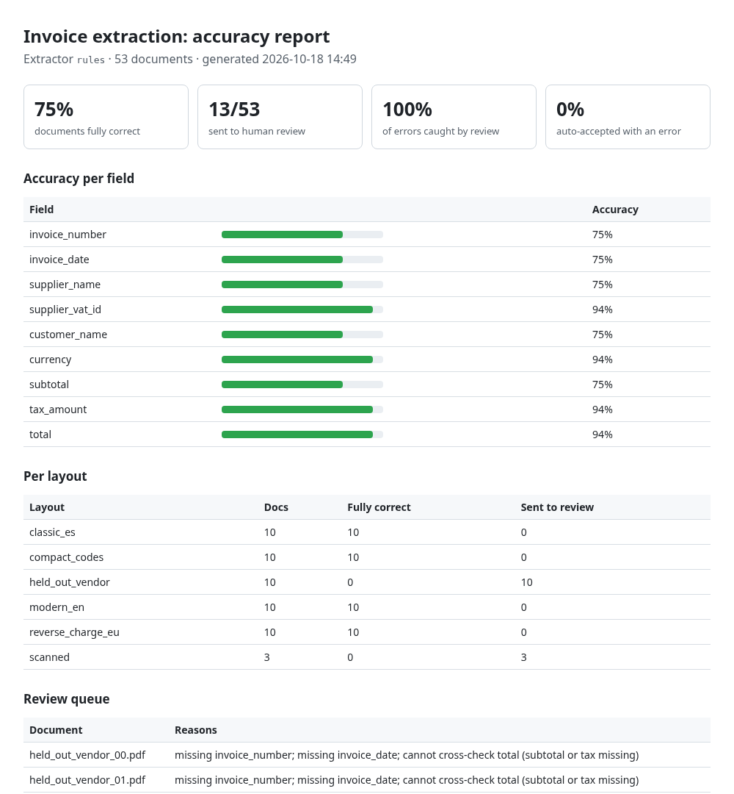
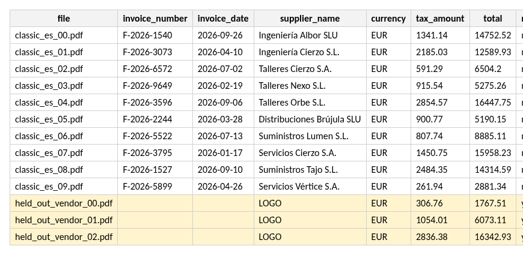
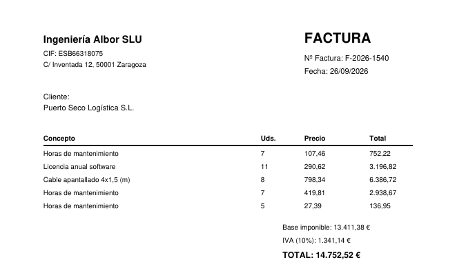
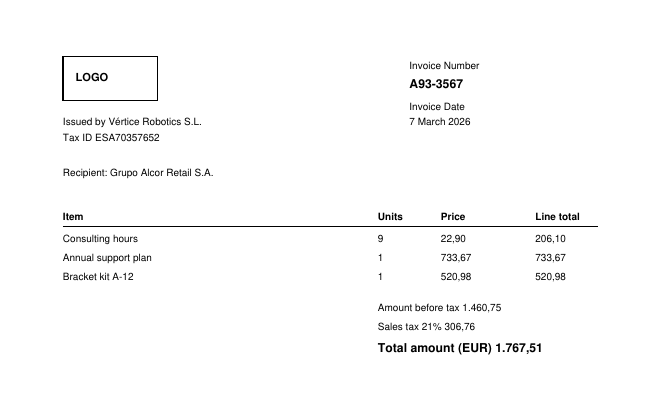

# invoice-extract-eval

**Extract invoice fields from PDFs into a spreadsheet, measure how accurate the extraction really is, and send every doubtful document to a human review queue instead of guessing.**



Most "AI PDF extraction" demos show one invoice that works. This repo shows the part that matters when the data goes into accounting:

1. **Ground truth and per-field accuracy.** Every run can be scored against known answers.
2. **A review queue driven by business rules.** It catches missing fields, `subtotal + tax ≠ total`, future dates, missing VAT IDs, and image-only scans.
3. **An honest held-out test.** A layout written *after* the extraction rules were frozen, so you can see how the pipeline behaves on documents it was not tuned for.

Everything runs offline, with no API key and no GPU. An optional LLM extractor can be switched on with any OpenAI-compatible endpoint, including a local model.

## Results on the bundled synthetic dataset

`invoice-extract generate && invoice-extract run` (rules extractor, 53 documents):

| Layout | Docs | Fully correct | Sent to review |
|---|---|---|---|
| classic_es (Spanish, `1.234,56 €`, discount lines) | 10 | 10 | 0 |
| modern_en (English, `$1,234.56`, two-column header, shipping line) | 10 | 10 | 0 |
| compact_codes (label and value in separate columns, ISO dates) | 10 | 10 | 0 |
| reverse_charge_eu (0 % VAT, legal footer with numbers) | 10 | 10 | 0 |
| **held_out_vendor** (written after rules were frozen) | 10 | **0** | **10** |
| **scanned** (image-only PDFs, no text layer) | 3 | **0** | **3** |

- **Auto-accepted documents that still had an error: 0 %**
- **Errors caught by the review queue: 100 %**

The held-out layout is deliberately left untuned. The rule-based extractor misses its labels ("Invoice Number" with the value on the next line, "Recipient:", "Amount before tax") and picks "LOGO" as the supplier. The validation layer notices the missing fields and routes all 10 documents to review, so nothing wrong reaches the spreadsheet unflagged. That is the property a client should demand from any extraction pipeline, rule-based or LLM-based.

Full report: [`sample_output/report.md`](sample_output/report.md) · spreadsheet: [`sample_output/extracted.xlsx`](sample_output/extracted.xlsx)



| Known layout (`classic_es`) | Held-out layout |
|---|---|
|  |  |

> All companies, people and VAT numbers in the samples are randomly generated and fictional.

## Quick start

```bash
python -m venv .venv && source .venv/bin/activate
pip install -e ".[dev]"

invoice-extract generate --out samples        # 50 synthetic invoices + 3 scans, with ground truth
invoice-extract run --input samples --out out # extract, validate, score, write reports
open out/report.html                          # or xdg-open on Linux
pytest -q
```

Run it on your own PDFs by pointing `--input` at a folder. If a `name.truth.json` file sits next to each `name.pdf`, you also get the accuracy report. Without it, you still get `extracted.xlsx` and `extracted.json`, with the review flags.

Outputs:

| File | Content |
|---|---|
| `extracted.xlsx` | One row per invoice, money and date columns typed, review rows highlighted, `accuracy` sheet |
| `extracted.json` | Same data for downstream systems (ERP import, n8n, webhook) |
| `report.md` / `report.html` | Per-field accuracy, per-layout breakdown, review queue with reasons, every field error |

## Optional: LLM extractor

```bash
# Hosted provider (any OpenAI-compatible API)
export LLM_API_KEY=...            # set a spending limit on the key
export LLM_MODEL=gpt-4o-mini      # or another model
invoice-extract run --extractor llm --out out-llm

# Fully local, no key: e.g. Ollama
export LLM_BASE_URL=http://localhost:11434/v1
export LLM_MODEL=qwen2.5:7b-instruct
invoice-extract run --extractor llm --out out-llm
```

The LLM receives the page text with columns separated by `|`. Its JSON answer goes through the **same normalisers and the same validation and review rules** as the rules extractor, so both are scored the same way and can be compared like for like.

**Status:** the LLM path is covered by unit tests with a fake transport (`tests/test_pipeline.py`). The numbers above are for the offline rules extractor only. **No LLM results are claimed here** until they have been run.

## How it works

```
PDF ──► pdf_text.read_lines()       words → lines → column segments (keeps side-by-side blocks apart)
    ──► extractor (rules | llm)     label anchors + layout lookups, or an LLM returning JSON
    ──► normalize                   '1.234,56' / '$1,234.56' → Decimal; 3 date styles → date; VAT ID formats
    ──► validate.review_reasons()   required fields, subtotal + tax = total (±0.02), dates, VAT ID, no-text scans
    ──► evaluate (if ground truth)  per-field accuracy, docs fully correct, review-queue recall
    ──► excel / report              xlsx + json + md/html
```

```
src/invoice_extract/
  pdf_text.py          layout-aware line and column segmentation (pdfplumber)
  normalize.py         amounts, dates, currencies, VAT IDs
  extractors/rules.py  offline baseline
  extractors/llm.py    OpenAI-compatible client (stdlib only), local or hosted
  validate.py          business rules → review queue
  evaluate.py          scoring against ground truth
  samples.py           synthetic invoices: 4 tuned layouts + 1 held-out + scans
  report.py, excel.py, cli.py
```

## Limitations (on purpose, stated up front)

- **Synthetic data.** The four tuned layouts score 100 % because the rules were written against them. Real supplier invoices vary more. That is why the held-out layout and the review queue exist, and why a client project starts by scoring 20 real documents before anything is automated.
- **No OCR in the base install.** Scanned PDFs are detected and routed to review. Adding Tesseract or a vision model is a drop-in extractor.
- **First page only, one invoice per file.**
- **VAT IDs are format-checked, not validated against VIES.**

## Using this for a real project

1. Collect 20-50 representative documents and write their expected values (the `.truth.json` format).
2. Run the baseline, read the report, and decide per field whether rules, an LLM or a combination is needed.
3. Agree on an acceptance target per field and on what goes to human review.
4. Hook the JSON output into the destination (spreadsheet, ERP import, n8n webhook) and re-score on every change.

## License

MIT, see [LICENSE](LICENSE).
